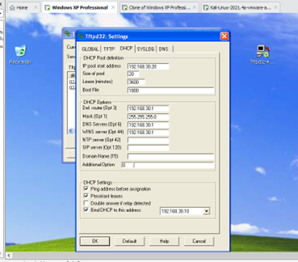
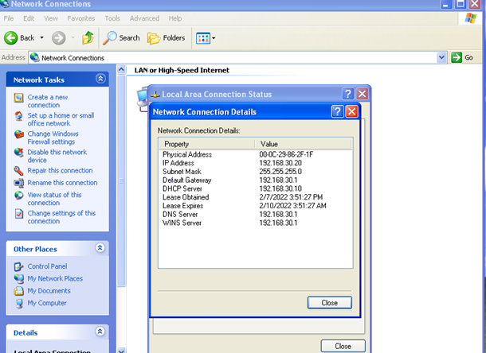
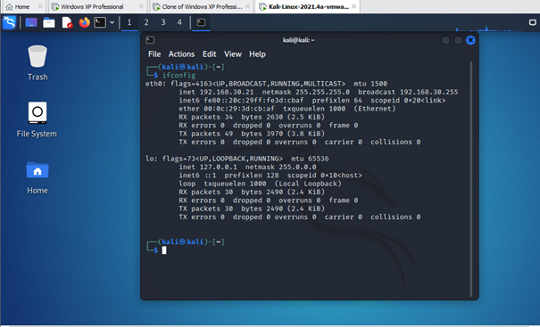
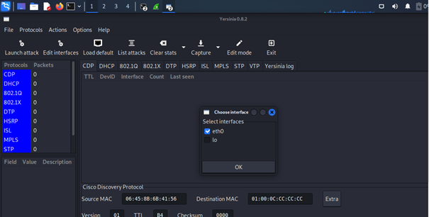
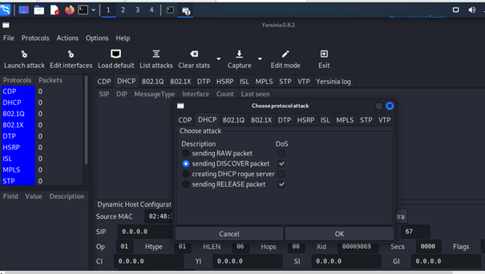
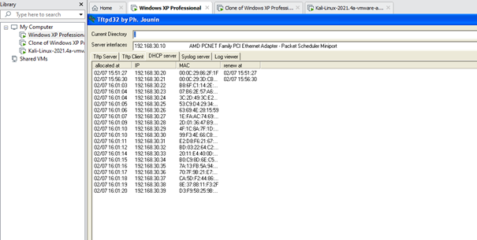
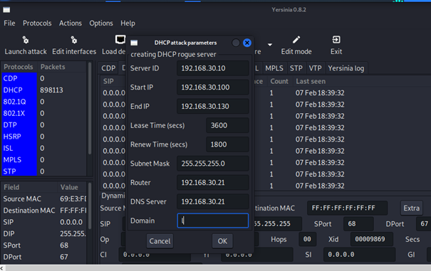
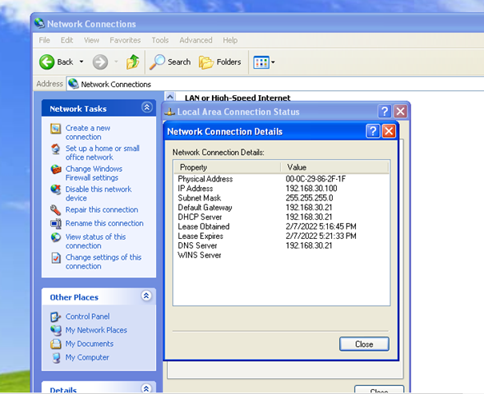
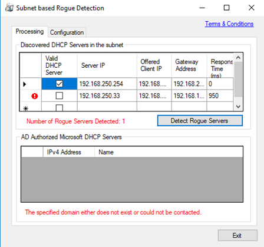

# Attaque et détection d'un serveur DHCP non autorisé (Rogue DHCP)

   

Ce projet simule une attaque par serveur DHCP non autorisé (Rogue DHCP) sur un réseau local, puis présente des méthodes pour détecter ce type d'attaque.

Rapport complet au format PDF : [docs/rapport-rogue-dhcp.pdf](docs/rapport-rogue-dhcp.pdf)

## Sommaire

1. [Objectifs](#objectifs)
2. [Qu'est-ce qu'un Rogue DHCP](#quest-ce-quun-rogue-dhcp)
3. [Principe de l'attaque](#principe-de-lattaque)
4. [Environnement](#environnement)
5. [Outils utilisés](#outils-utilisés)
6. [Déroulement de l'attaque](#déroulement-de-lattaque)
7. [Détection](#détection)
8. [Prévention](#prévention)
9. [Compétences mises en œuvre](#compétences-mises-en-œuvre)
10. [Structure du dépôt](#structure-du-dépôt)
11. [Avertissement](#avertissement)
12. [Auteur](#auteur)

## Objectifs

- Comprendre le fonctionnement d'une attaque Rogue DHCP
- Simuler l'attaque dans un environnement de laboratoire
- Présenter des méthodes de détection, manuelles et outillées

## Qu'est-ce qu'un Rogue DHCP

Un Rogue DHCP est un serveur DHCP introduit sur un réseau par un attaquant, ou parfois par un utilisateur non averti, sans être sous le contrôle des administrateurs réseau. Il peut attribuer de fausses adresses IP et de fausses informations réseau, perturber les connexions ou empêcher les machines d'accéder aux services du réseau.

## Principe de l'attaque

Un attaquant met en place un serveur DHCP non légitime et se fait passer pour un serveur autorisé. Les machines clientes qui récupèrent leur configuration auprès de ce serveur deviennent vulnérables à une attaque de l'homme du milieu (MITM), car leur trafic passe alors par la machine de l'attaquant positionnée comme passerelle par défaut.

L'attaque se déroule en deux étapes.

| Étape | Description |
|---|---|
| DHCP Starvation | L'attaquant envoie un grand nombre de requêtes DHCP DISCOVER avec des adresses MAC usurpées, jusqu'à épuiser les adresses IP disponibles sur le serveur légitime |
| DHCP Spoofing | Une fois le serveur légitime saturé, l'attaquant met en place son propre serveur DHCP et distribue de fausses informations, notamment une passerelle et un serveur DNS qu'il contrôle |

## Environnement

| Machine | Rôle |
|---|---|
| Kali Linux | Machine attaquante |
| Windows (serveur) | Héberge le serveur DHCP légitime avec Tftpd32 |
| Windows (client) | Machine cliente qui demande une adresse IP |

## Outils utilisés

| Outil | Usage |
|---|---|
| Tftpd32 | Serveur DHCP léger utilisé comme serveur légitime |
| Yersinia | Outil d'attaque réseau, utilisé pour la saturation et le serveur rogue |
| ipconfig /all, arp -a | Commandes Windows pour la détection manuelle |
| Outil de détection de type Rogue Check | Détection automatisée des serveurs DHCP non autorisés |

## Déroulement de l'attaque

### 1. Mise en place du serveur DHCP légitime

Le serveur Tftpd32 est configuré sur la machine Windows avec un pool d'adresses, une passerelle et un serveur DNS.



La machine cliente obtient bien une adresse IP, une passerelle et un DNS fournis par ce serveur.



### 2. Saturation du serveur légitime (DHCP Starvation)

Sur Kali, l'interface réseau est vérifiée avant de lancer l'attaque, afin de confirmer qu'elle se trouve sur le même réseau que la cible.



Yersinia est lancé avec l'option d'attaque DHCP. L'interface d'écoute est d'abord sélectionnée.



Dans Launch Attack, onglet DHCP, l'option Send Discover Packet est utilisée pour envoyer un grand nombre de requêtes DHCP DISCOVER au serveur légitime.



La table de baux du serveur légitime se remplit progressivement jusqu'à épuisement des adresses disponibles.



### 3. Mise en place du serveur Rogue DHCP

Une fois le serveur légitime saturé, l'option Creating DHCP Rogue Server de Yersinia permet de configurer un serveur DHCP malveillant sur la machine Kali, avec sa propre plage d'adresses, sa passerelle et son serveur DNS pointant vers l'attaquant.



En réactivant la carte réseau de la machine cliente, celle-ci obtient une nouvelle adresse IP appartenant au serveur rogue, avec la passerelle et le DNS de l'attaquant. Le trafic de la machine cliente passe alors par la machine Kali, qui se trouve en position de MITM.



## Détection

### Méthode manuelle

Sur la machine cliente, deux commandes Windows permettent d'identifier un serveur DHCP suspect.

```text
ipconfig /all   → identifie l'adresse du serveur DHCP ayant répondu
arp -a          → permet de retrouver l'adresse MAC correspondante
```

Une méthode consiste aussi à désactiver temporairement le serveur DHCP légitime, pour observer si une machine obtient malgré tout une adresse, ce qui révèle la présence d'un autre serveur sur le réseau.

### Méthode outillée

Un outil de détection de type Rogue Check interroge le réseau et liste l'ensemble des serveurs DHCP actifs, en distinguant les serveurs autorisés des serveurs suspects.



## Prévention

- Activer le DHCP Snooping sur les commutateurs du réseau
- Segmenter le réseau pour limiter la portée d'un serveur rogue
- Surveiller le réseau avec un SIEM ou un IDS
- Contrôler les équipements autorisés à se connecter au réseau

## Compétences mises en œuvre

Protocole DHCP, attaques réseau de type MITM et spoofing, analyse réseau, détection d'intrusion, sécurisation d'infrastructure.

## Structure du dépôt

```text
rogue-dhcp-detection/
├── README.md
├── docs/
│   └── rapport-rogue-dhcp.pdf
└── images/
    └── captures d'écran numérotées dans l'ordre du déroulement
```

## Avertissement

Ce projet a été réalisé dans un environnement de laboratoire isolé, sur des machines virtuelles personnelles et à des fins pédagogiques. Cette attaque ne doit jamais être menée sur un réseau sans autorisation écrite préalable.

## Auteur

Hyppolyte Gbedo
Licence Informatique, Université de Rennes 1
Orienté SOC et cybersécurité
GitHub [gbehyppolyte-sec](https://github.com/gbehyppolyte-sec)
